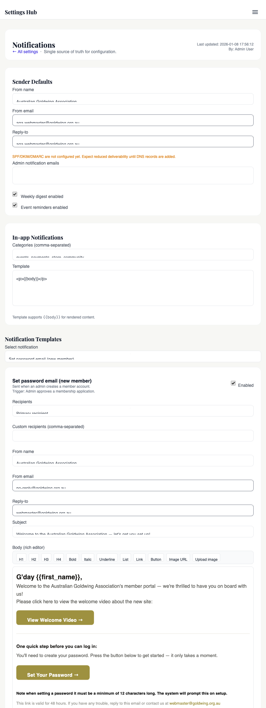

# Notifications & email

## For administrators

### What this is

Every email the site sends — to members and to admins — runs through the same place. The welcome email when someone joins, the renewal reminder, the order confirmation with the invoice attached, the refund notice, the password-reset link, the 2FA code at login, the "a webhook failed" alert that lands in the admin inbox — all of it goes through one shared notification system.

That means there's one place to change the wording, one place to change who emails come *from*, one place to plug in the mailbox the site actually sends through, and one place to look when a member says "I never got it".

### What it lets you do

- **Edit the wording** of any email the site sends — subject line, body text, sender name.
- **Change the sender address** (the "From" everyone sees in their inbox).
- **Configure SMTP** so emails go out through a real mailbox, not the web host's anonymous PHP mailer (which usually lands in spam).
- **Turn individual emails on or off** without touching code.
- **Send test emails** to make sure things work before a real member is on the receiving end.
- **See what got sent** — there's an email log so you can prove "yes, we sent it on Tuesday at 3pm".
- **See in-app admin alerts** in the Notification Hub for things needing a webmaster decision.
- **Email each new Wings issue to members** from Admin → Wings, after checking the list and the email first, then see who got it and who opened it.

### Who's allowed

**Admin** only. Editing email templates, switching the sender domain, and changing SMTP credentials are all admin-level — they affect every member and can easily break delivery for the whole site if set wrong.

### Where to find it in admin


{{link:/admin/settings/?section=notifications|Take me to Notifications}}
{{link:/admin/settings/?section=integrations|Take me to Integrations}}

Three places, depending on what you're trying to do:

1. **Admin → Settings → Notifications** — every email template the site sends. Edit copy, change subject lines, toggle individual emails on/off, set per-template recipients, send a test.
2. **Admin → Settings → Integrations** — SMTP credentials (host, port, username, password, encryption) and the choice of email provider.
3. **Admin → Notification Hub** (`/admin/requests/`) — the in-app inbox for items needing a webmaster decision (noticeboard submissions, event proposals, Fallen Wings tributes, nominations). Not an email inbox — it's the admin "to-do" list.

### The emails the site sends

| Email | When it goes out | Who gets it |
|---|---|---|
| **Welcome / set password** | Admin approves a new member application | New member |
| **Membership application approved** | Admin approves an application | Applicant |
| **Membership application rejected** | Admin rejects an application | Applicant |
| **Renewal reminder** | Membership is about to expire (cron job) | Member |
| **Order confirmation + invoice** | Member completes checkout | Member |
| **Order ready for review (bank transfer)** | Bank-transfer order needs admin approval | Admin |
| **Payment received** | Stripe confirms the payment | Member |
| **Payment failed** | Stripe rejects a payment | Member |
| **Refund issued** | Admin issues a refund (Ch 17) | Member |
| **Shipping update** | Admin saves a tracking number | Member |
| **Ticket codes** | Event tickets are issued | Member |
| **Password reset** | Member or admin requests one | Member |
| **2FA enrolment code** | Login requires email OTP (Ch 06) | Member or admin logging in |
| **Notification Hub: approved / denied / feedback** | Webmaster actions a pending request | Submitter |
| **Notification Hub: new request** | Member submits something needing review | Webmaster |
| **New store order (admin copy)** | A paid store order comes in | Admin |
| **Admin security alerts** | FIM change, webhook failure, repeated failed login, refund created, member import/export, new admin device | Security alert recipient |
| **New Wings issue** | An admin presses Send on Admin → Wings → Email to members | Every current member with an email address, minus anyone unticked or opted out |

### Two channels: transactional vs notification

Emails fall into two buckets, and they behave differently:

- **Transactional emails** — these *always* go out, no matter what. Password reset, 2FA login code, membership approval, order confirmation, payment receipt. A member can't opt out of these for the same reason they can't opt out of a bank statement — they need them to use their account.
- **Notification emails** — renewal reminders, shipping updates, refund notices, ticket codes, request feedback. Members *can* opt out of these per-category if they don't want them. Every one of these emails carries an unsubscribe footer.

If a member complains they're getting "too much email", point them at notification-email opt-outs. They will still get the essentials.

### How a member opts out

Two routes for the member:

1. **Member profile → Notification preferences** — granular per-category toggles (calendar, noticeboard, orders, payments, admin, Wings magazine, security), plus a master switch and a one-click "unsubscribe from all non-essential emails".
2. **The footer of any non-essential email** — every notification email carries an "Update email preferences" and "Unsubscribe from all non-essential emails" link. These work without logging in (the link contains a token that's good for 7 days).

Members **cannot** opt out of transactional emails. That's intentional.

### Emailing a new Wings issue

{{link:/admin/index.php?page=wings|Take me to Wings}}

Once this month's issue is uploaded (with its cover image, which the email is built around), press **Email to members** on it. The Wings page shows whether each issue has been emailed yet, and how many members opened it.

1. **Check the email.** The left side shows the email exactly as members will see it. The subject is filled in for you; change it if you like. Add a **personal message** if there's something to say about this issue — it appears in a gold box above the cover. Press **Send me a test** to get a copy in your own inbox first.
2. **Check who gets it.** The right side lists every current (Active) member with an email address, all ticked. Print and digital members are both on it, because everyone gets the emailed copy. A couple sharing one inbox shows as one line and gets one email ("G'day John & Mary"). **Untick anyone who shouldn't get this issue.** The search box finds people by name, email, member number or chapter.
3. **Press Send.** You'll be asked to confirm, and possibly to re-enter your password. The next screen sends the emails in small batches with a progress bar. **Keep that page open until it says "All done."** If you close it early, open the report again (from the Wings page) and press **Resume sending**. Nobody gets a second copy.
4. **Read the report.** It lists every member with Sent / Failed / Removed / Opted out, and when they opened it. If some failed, press **Retry failed**.

Good to know:

- **Each member's buttons open the magazine straight away.** Their email carries a personal link, so there's no login or password needed. That matters because plenty of members have never set up their portal login. The link only opens that one issue.
- **Members who switched off Wings emails** (or all non-essential email) in their preferences are listed separately and left off. They can switch it back on themselves.
- **Members with no email address** can't be emailed. The page tells you how many there are; they're on the printed mailing list.
- **Sending the same issue again emails everyone ticked a second time.** The page warns you if the issue has already gone out.
- **Who can send it:** admins, and anyone given the **Wings Distributor** role. That role sees only the Wings page and this screen. To give it to someone, open their member profile → **Roles & Access**, tick **Wings distributor** and save; they need to log out and back in once. Chapter-restricted (area rep) accounts see a notice instead, because the email goes to the whole club.
- **There's a daily sending limit**, 80 a day to start with. Resend's free plan allows only 100 emails a day for the whole site, and receipts, password resets and login codes count towards that too. When a send reaches the limit it pauses and tells you when the next lot can go; come back then and press **Resume**. On a paid Resend plan (no daily cap), set the limit to 0 with **Change** at the top of the screen. It also sends no faster than 2 emails a second, well inside Resend's per-second limit.
- **If every email in a batch fails**, the send stops itself instead of working through the whole list. That usually means the email service is refusing (daily quota used up, a login problem or an outage). Fix that, then press **Resume**, and **Retry failed** at the end.

### SMTP setup walkthrough

{{link:/admin/settings/?section=integrations|Take me to Integrations}}

Out of the box the site uses PHP's built-in `mail()` function, which on a shared host means anonymous mail relayed through the server. Most inboxes land that straight in spam. The fix is to point the site at a real mailbox over SMTP — typically the `webmaster@goldwing.org.au` mailbox.

1. **Admin → Settings → Integrations → Email card.**
2. Choose the **provider**: `SMTP` (the usual choice) or `Resend` (if you've signed up to resend.com — useful when shared-host SMTP is flaky). Leave as `PHP mail` only if you have no other option.
3. Fill in:
   - **Host** — e.g. `mail.goldwing.org.au` or your provider's SMTP server.
   - **Port** — usually `587` (TLS) or `465` (SSL).
   - **Encryption** — `TLS` for port 587, `SSL` for port 465.
   - **Username** — the full email address (`webmaster@goldwing.org.au`).
   - **Password** — the mailbox password. This is stored encrypted; once saved the field shows "Configured - leave blank to keep" so you don't have to retype it on every save.
4. Click **Save**.
5. Go to **Settings → Notifications**, pick any template, and click **Send test** to send yourself a test email. If it arrives, you're done. If not, see the next section.

### What can go wrong

- **"SMTP authentication failed"** — wrong username or password, or the mailbox doesn't allow SMTP. Log into the mailbox in webmail to confirm the password works, then re-enter it on the Integrations page. Some hosts require you to enable "SMTP / less secure apps" on the mailbox first.
- **A member says they never got the email** — first check **Settings → Notifications** and confirm that template is **enabled**. Then check the email log (or ask your developer to query it) and see if it shows the email was sent. If it was sent, it's almost certainly in their spam folder — ask them to check there and mark you as "not spam". If it was *not* sent, the SMTP transport probably failed — see below.
- **All emails are landing in spam** — three usual causes: (1) the site is sending as `no-reply@goldwing.org.au` but SPF/DKIM/DMARC records on the domain aren't set up — get your DNS host to add them; (2) the SMTP server isn't authenticating cleanly — make sure you're using a real mailbox, not anonymous relay; (3) the sending IP has been flagged on a blocklist — check it at MXToolbox.
- **OTP codes / 2FA codes aren't arriving** — these are mandatory transactional emails and bypass opt-outs, so if they're missing it's a transport problem. Send a test from the Notifications page. If the test doesn't arrive either, SMTP is broken. Until you fix it, members and admins can't log in via email OTP.
- **The "From" address won't change** — the site only allows sender addresses on the `goldwing.org.au` domain. This is deliberate — it stops a hijacked admin account from sending mail as a third party. If you really need a different domain, your developer has to change the validation rule.
- **Encrypted SMTP password "stopped working"** — if the site's encryption key (`APP_KEY`) was rotated or lost, every encrypted secret becomes unreadable, including the SMTP password. Re-enter the password on the Integrations page.
- **Part of a Wings send failed** — usually the email service's quota. Resend's free plan allows 100 emails a day for the whole site, so if other mail used it up, the send stops itself after a batch of failures. Once the quota resets (midnight UTC, which is 10–11am in Sydney), open the report, press **Resume**, then **Retry failed**. Only the failed ones are re-sent. Lowering the daily limit on the Email Wings screen stops it happening again.

### What gets recorded

- **Sent emails log** — every email the site tries to send writes a row to the email log with recipient, subject, transport used, and whether the send succeeded. Useful for "did we send it?" questions.
- **Activity log** — Admin → Security Log records every `email.sent` event with a snapshot of the subject and body, plus `email.smtp_failed` when the transport drops one.
- **Notification template changes** — edits to a template's wording, subject, sender, or on/off state are logged through the settings audit (Ch 31).

### Good practice

- **Use a dedicated SMTP mailbox for the site** — typically `webmaster@goldwing.org.au` or similar. Don't point it at a personal mailbox; if the password rotates the site goes silent.
- **Send a test after any SMTP or template change.** The "Send test" button next to every template is the fastest way to catch a broken transport before a real member hits it.
- **Don't change the sender domain casually.** Members' email clients learn that `no-reply@goldwing.org.au` is "us"; if you suddenly start sending from somewhere else, more of it lands in spam and members get confused.
- **Once a quarter, check the domain's email reputation** at MXToolbox or Spamhaus. Catches blocklist issues before members start complaining.
- **Don't disable transactional emails to "reduce noise".** Turning off the password-reset email locks members out of their own accounts.
- **Keep the unsubscribe footer working.** If a template stops including it, you risk anti-spam legislation on the bulk-email ones. The system adds the footer automatically — just don't let anyone strip it out of the template body.

### Who to ask if stuck

- **SMTP password / mailbox issues** — the webmaster or whoever runs the email hosting.
- **Domain reputation, SPF/DKIM/DMARC records** — whoever manages the DNS for `goldwing.org.au`.
- **Site won't accept the "From" address** — your developer (it's the anti-spoof check rejecting it).
- **Encryption key lost / SMTP password reads garbage** — your developer (see Ch 10).
- **An email template needs new variables (e.g. "include the member's chapter")** — your developer; templates use `{{tokens}}` and the available list is fixed in code per-template.

---

<details>
<summary><strong>Dev notes</strong></summary>

### What this covers

Every email the site sends — welcome, renewal reminder, order confirmation, refund, password reset, login OTP, admin alert — flows through the same three-layer stack: `NotificationService` (the "tell user X about Y" catalogue), `EmailService` (compose, brand-wrap, log), and a transport (PHP `mail()`, SMTP via `SmtpMailer`, or Resend.com). This chapter also covers per-user opt-outs, unsubscribe tokens, the in-app Notification Hub at `/admin/requests/`, and the (stubbed) SMS path.

### Why it exists

- **Member contact at scale, editable without a deploy.** Subjects, bodies, sender names and per-template recipient modes live in `settings_global` → `notifications.catalog`. The webmaster can rewrite the renewal-reminder copy in the admin UI; no PR required. Default copy ships in `NotificationService::definitions()` so a wiped row falls back to sensible text.
- **Admin alerting that's separate from member email.** Security events (FIM changes, repeated failed logins, refunds) shouldn't share a recipient list or an opt-out switch with marketing. They go through `SecurityAlertService` to a dedicated alert email, gated by `alerts.*` flags in `security_settings` — see [Chapter 11 — File integrity monitoring](view.php?slug=11-file-integrity).

### How it works

#### The three layers

```
caller
  │  NotificationService::dispatch('membership_approved', $context)
  ▼
NotificationService    ← catalogue lookup, recipient mode, opt-out check, {{token}} substitution
  │  EmailService::send($to, $subject, $body, $metadata)
  ▼
EmailService           ← brand-wrap, preferences/unsubscribe footer, log to email_log + ActivityLogger
  │  transport per integrations.email_provider
  ▼
SmtpMailer  |  Resend API  |  PHP mail()
```

**`NotificationService::dispatch($key, $context, $options)`** looks the key up in `getCatalogSettings()` (defaults merged with DB overrides), bails if the per-template `enabled` flag or the global kill-switch `notifications.enabled` is off (unless `options.force = true`), resolves recipients from `recipient_mode` (`primary` / `admin` / `both` / `custom`), runs `NotificationPreferenceService::shouldReceive()` for non-mandatory templates, substitutes `{{tokens}}`, and calls `EmailService::send()` once per recipient. `options.recipients` is an **exact-recipient override** that skips catalog recipient resolution entirely — used by Member of the Year nominations so they go *only* to the configured MotY recipient (`notifications.member_of_year_emails`, Settings → Notifications), never the shared admin list, even if the catalog row has stale custom recipients.

**`EmailService::send($to, $subject, $body, $metadata)`** is the lower-level "just send this email" call — also used directly by `InvoiceService`, `SecurityAlertService`, `cron/send_renewal_reminders.php`, and admin tools. It wraps the body in the gold-branded HTML shell (`wrapHtml()`) unless it already carries `data-email-template="goldwing"`, appends a tokenised preferences/unsubscribe footer (skipped for mandatory templates), picks the transport from `integrations.email_provider` (`php_mail` default / `smtp` / `resend`), and logs the attempt to `email_log` plus an `email.sent` ActivityLogger event with the full subject + body snapshot for replay.

**`SmtpMailer`** is a hand-rolled SMTP client (`fsockopen` + EHLO/STARTTLS/AUTH LOGIN/DATA). It reads `integrations.smtp_*`, supports `tls`/`ssl`/none, wraps long lines at 990 bytes and escapes leading dots — the basics PHPMailer would otherwise handle. **Resend.com** is the alternative HTTP transport: set `integrations.email_provider = 'resend'` and `integrations.resend_api_key` and `EmailService` POSTs to `https://api.resend.com/emails` instead. Useful when shared-host SMTP is flaky.

#### Templates and the {{token}} system

There's no separate template directory. Each notification's HTML body lives inline in `NotificationService::definitions()` as `defaults.body`. The webmaster overrides `subject`, `body`, `from_name`, `from_email`, `reply_to`, `recipient_mode`, `custom_recipients`, and `enabled` per-template via Admin → Settings → Notifications → Catalogue. Overrides land in `notifications.catalog` as a JSON map keyed by template ID.

Token substitution is intentionally naive — `{{member_name}}`, `{{order_number}}`, `{{reset_link}}` etc. are replaced by a `strtr()` over the context array. No conditional logic, no loops; for lists (items, tickets), the caller pre-renders the HTML and passes it as one token (`{{items_html}}`, `{{ticket_list_html}}`). Each definition declares its supported `placeholders` so the settings UI can show them.

#### What gets sent, and when

| Template key | Trigger | Mandatory? |
|---|---|---|
| `member_set_password` | Admin approves application | yes |
| `member_password_reset_self` / `_admin` | Member or admin requests reset | yes |
| `security_email_otp` | Login requires email OTP (Ch 06) | yes |
| `application_member_submitted` | Public apply.php form submitted (applicant) | no |
| `application_admin_new_submission` | Public apply.php form submitted (admin alert) | no |
| `application_member_approved` | Admin approves a membership application | no |
| `membership_approved`, `membership_order_created`, `membership_payment_received` | Approval / order / Stripe webhook | yes |
| `membership_treasurer_notification` | Paired with `membership_payment_received` for admins | no |
| `membership_admin_stripe_pending` | Member reaches the Stripe payment form for a membership (admin heads-up, pre-charge; first attempt per order only) | no |
| `membership_admin_payment_issue` | Stripe reports a membership payment failed / invoice failed / subscription cancelled (admin copy) | no |
| `membership_order_approved/rejected`, `membership_payment_failed` | Admin action / Stripe failure | no |
| `membership_admin_pending_approval` | Bank-transfer order needs review | no |
| `store_order_confirmation`, `store_ticket_codes`, `store_shipping_update` | Store checkout / tracking saved | mixed |
| `store_refund_processed` | `RefundService` issues a refund (Ch 17) | no |
| `store_admin_order_placed` | Store checkout reaches payment step (admin, pre-pay) | no |
| `store_admin_new_order` | New paid store order (admin only) | no |
| `request_approved/denied/feedback`, `webmaster_new_request` | Notification Hub actions | no |

Renewal reminders are sent by `cron/send_renewal_reminders.php`, which calls `EmailService::send()` directly and additionally fires `SmsService::send()` for members with a phone number — see [Chapter 19 — Membership lifecycle](view.php?slug=19-membership-lifecycle).

Security alerts (FIM changes, repeated failed logins, new admin device, refund created, member import/export, Stripe webhook failures) bypass the catalogue and go through `SecurityAlertService::send($type, $subject, $body)` — internal-only and gated by `alerts.$type` in `security_settings`.

#### OTP, unsubscribe tokens, per-user opt-outs

- **`EmailOtpService::issueCode()`** generates a 6-digit code, stores its `password_hash`, and dispatches `security_email_otp` with `force = true` (so opt-outs and the master switch can't block it). 10-minute expiry, max 5 attempts, 60-second resend cooldown, 5 resends/hour. See [Chapter 06 — 2FA, step-up & trusted devices](view.php?slug=06-2fa-stepup).
- **`EmailPreferencesTokenService::createToken($memberId, 'preferences' | 'unsubscribe')`** mints a `CryptoService::encrypt()`-wrapped token (member ID, purpose, 7-day expiry). Every non-mandatory email gets a footer with tokenised "Update email preferences" and "Unsubscribe from all non-essential emails" links, so members can opt out without logging in. Landing page is `/email_preferences.php`.
- **`NotificationPreferenceService`** stores per-user opt-outs in `settings_user.notification_preferences`: a `master_enabled` switch, an `unsubscribe_all_non_essential` flag, and per-category booleans (`calendar`, `noticeboard`, `orders`, `payments`, `admin`, `wings`, `security`). Mandatory templates short-circuit the check — you can't opt out of password reset. A category missing from a member's saved prefs falls back to `notifications.default_categories` (default on), so adding `wings` left everyone opted in.

#### Wings issue email (`WingsSendService`)

Admin → Wings → **Email to members** opens `/admin/wings-send.php?issue=<id>` (permission `admin.wings_magazine.manage`, held by `admin` and the `wings_distributor` role from Migration 057; chapter-restricted admins are refused). The page and `?page=wings` are listed in `access_control_self_gated_permission()` so a Role Builder role holding that permission gets past the role registry ([Chapter 07](view.php?slug=07-roles-permissions)). It is not a catalogue template: the layout is fixed in `WingsSendService::renderEmail()` (cover, month, title, gold "Read the magazine" button, download link) wrapped by `EmailService::wrapHtml($subject, $body, 'Wings Magazine')`. Only the subject and an optional plain-text message are typed per send.

- **Audience** — `WingsSendService::audience()`: `LOWER(members.status) = 'active'` with a usable `members.email` (skips blanks, invalid addresses, `+stub@` roster stubs and `@goldwing.invalid` placeholders). `wings_preference` is ignored on purpose: club policy is that everyone gets the emailed copy (same rule as `export.php?list=email_pdf`), and that column's print values are unreliable. Members sharing an address collapse into one entry keyed by the full member's id. Anyone on that inbox with a user account whose prefs fail `shouldReceive($userId, 'wings')` marks the entry `opted_out`.
- **Send** — the form posts the ticked keys; `createSend()` re-reads the audience and freezes it into `wings_sends` + `wings_send_recipients` (`queued` / `removed` / `opted_out`, each with a random 32-hex `token`), so a posted key can only select from the list, never add to it. A session nonce stops a double-click from creating two sends, and the POST passes `require_stepup()`.
- **Batches** — the report page loops AJAX `action=batch` → `sendBatch()` (`BATCH_SIZE` 10, 0.5 s between emails, so at most 2 a second: inside Resend's 10/s team limit and the 2/s older accounts had) until nothing is `queued`. Batches are serialised with MySQL `GET_LOCK('wings_send_batch', 30)`. Each row is claimed by flipping `queued → sent` before mailing and set to `failed` if `EmailService::send()` returns false: at most once, so parallel tabs or a crash never double-send. `retryFailed()` re-queues failures. A batch where every email failed comes back `stalled` and the loop stops, so a refused quota doesn't burn through the whole list.
- **Daily limit** — `wings.daily_send_limit` (default `DEFAULT_DAILY_LIMIT` = 80, 0 = off, set with **Change** on the review screen). `sendBatch()` sends at most `limit − sentLast24h()`; past it, the counts carry `paused_until` (`nextSendAt()`: when the oldest send in the window turns 24 hours old, computed as seconds-from-now in SQL so the DB server's clock zone can't skew it) and the page waits for a person to press Resume. The window is rolling 24 hours, so no calendar day can exceed the limit, including Resend's free-plan quota, which resets at midnight UTC. It only counts Wings emails, so keep it below the provider's daily quota to leave room for the site's other mail. There is no cron: a capped send carries on when someone presses Resume.
- **Personal links** — `read_wings.php?t=` and `download_wings.php?t=` accept a token in place of a login (`recipientForToken()`; only rows with `status = 'sent'` work) and fall back to `require_login()` otherwise. `enforce_page_access()` in `includes/access_control.php` lets those two paths through when `?t=` is present, because the `/member/*` registry row would otherwise bounce them to `/login.php` before the page runs. Opening sets `opened_at` and logs `wings.read` / `wings.download` with `via: email_link` against the member, which feeds the Reports page.
- **Tables** — Migration 056 ([Chapter 03](view.php?slug=03-database-migrations)).

#### SMS and the Admin Notification Hub

`SmsService::send($to, $message)` exists but **does not actually deliver SMS** — it inserts into `sms_log` and returns `true`. Wired into admin approval flows (`/admin/index.php`) and `cron/send_renewal_reminders.php`. To turn it on, swap the body for a Twilio / MessageBird HTTP call reading credentials from `integrations.*`.

`/admin/requests/` (`PendingRequestsService`) is the in-app inbox for items needing a webmaster decision: noticeboard submissions, event proposals, Fallen Wings tributes, nominations. It is **not** an email queue — emails are dispatched separately via the `webmaster_new_request` / `request_approved` / `request_denied` / `request_feedback` templates from `/admin/requests/actions.php` when the admin clicks the action.

One hub type is **informational only**: "Details Updated" (`profile_update`, table `member_profile_updates`) logs member self-service profile edits — email, phone, postal address, privacy/directory flags — with old → new values. No approval is involved and no email is sent; the only action is "Mark as Read" (archive). It exists so the committee can review what changed before a CSV export or mail-out. Entries are written best-effort from the member portal's `update_profile` and `update_shipping` handlers via `PendingRequestsService::recordProfileUpdate()`.

### Where to change it

- **Email copy, subject, sender, recipients, on/off:** Admin → Settings → **Notifications** tab → Catalogue. Each row has a preview + a "Send test" button.
- **Default sender, admin recipients, master kill-switch:** top of the Notifications tab (writes to `notifications.from_*`, `notifications.admin_emails`, `notifications.enabled`).
- **SMTP host / port / user / password / encryption / Resend API key:** Admin → Settings → **Integrations** → Email card. The password input is write-only and shows "Configured - leave blank to keep" once set.
- **Member-facing opt-outs:** Member → Settings → Notifications, or any unsubscribe link in an email footer.
- **Wings issue email:** layout in `WingsSendService::renderEmail()`; audience rule in `WingsSendService::audience()`; the review/send/report screens in `public_html/admin/wings-send.php`.
- **Admin security-alert recipient + which alert types fire:** Admin → Settings → Security → Alerting (`security_settings.alert_email`, `alerts.*`).

### Settings

| Key | Default | Notes |
|---|---|---|
| `notifications.enabled` | `true` | Master kill-switch — when `false`, only `force = true` calls send. |
| `notifications.from_name` | `Australian Goldwing Association` | Default From-name. |
| `notifications.from_email` | `no-reply@goldwing.org.au` | Default From-email. Validated against `*@goldwing.org.au`. |
| `notifications.reply_to` | `webmaster@goldwing.org.au` | Default Reply-To. |
| `notifications.admin_emails` | `''` | Comma/newline list used when `recipient_mode = admin` or `both`. Falls back to `site.contact_email`. |
| `notifications.catalog` | (from `defaultCatalog()`) | Per-template overrides keyed by template ID. |
| `notifications.default_categories` | all `true` | Default per-category preferences for new members. |
| `integrations.email_provider` | `php_mail` | `php_mail`, `smtp`, or `resend`. |
| `integrations.smtp_host` / `_port` / `_user` | empty / `587` / empty | Standard SMTP triple. |
| `integrations.smtp_password` | empty | **Encrypted at rest** via `CryptoService` (see Ch 10). |
| `integrations.smtp_encryption` | `tls` | `tls`, `ssl`, or empty. |
| `integrations.resend_api_key` | empty | Bearer token for `https://api.resend.com/emails`. |
| `alerts.*` (in `security_settings`) | mostly `true` | `webhook_failure`, `role_escalation`, `failed_login`, `new_admin_device`, `refund_created`, `member_import`, `member_export`, `fim_changes`. |

### Gotchas

- **`integrations.smtp_password` is encrypted at rest** via `CryptoService` (`['encrypt' => true]` on `setGlobal`). Decryption needs `APP_KEY` in `.env`. If `APP_KEY` is rotated or missing, the password becomes garbage and SMTP auth fails silently — see [Chapter 10 — Encryption & secrets at rest](view.php?slug=10-encryption-secrets).
- **Per-user opt-outs do NOT suppress transactional emails.** Mandatory templates (password reset, OTP, membership approval/order/payment, store order confirmation) bypass `NotificationPreferenceService` entirely and omit the unsubscribe footer — they're account-essential, like a bank statement.
- **If SMTP fails, the email is dropped silently.** `EmailService::send()` returns `false` and logs `email.smtp_failed` to ActivityLogger; almost no caller checks the return. **Admin alerts that depend on the same SMTP will also fail** — if `SecurityAlertService` is the alarm and SMTP is broken, the alarm itself never rings. Use the FIM cron log or `email_log.sent = 0` queries to spot a transport outage.
- **`from_email` is validated against `goldwing.org.au`.** `EmailService::normalizeSenderEmail()` rejects anything that isn't `*@goldwing.org.au` and falls back to the default — deliberate anti-spoof guard so a hijacked admin can't change the From to a third-party domain.
- **Preference tokens are encrypted, not signed.** `EmailPreferencesTokenService` puts a `CryptoService`-encrypted blob in the URL with a 7-day `expires_at`. No server-side revocation list; rotating `APP_KEY` invalidates every outstanding token at once.
- **Wings "sent" means handed to the mailer, not delivered.** With `php_mail`, `mail()` returns true once the local MTA accepts the message; a host's per-hour cap can still discard it later without the site knowing. SMTP and Resend report refusals, which land as `failed` and can be retried.
- **Wings personal links don't expire.** A forwarded email lets whoever has it read that one issue (the same as forwarding a PDF, which is how Wings went out before). The test email has no recipient row, so its buttons point at the login-protected reader instead.
- **`SmsService` is a stub.** It logs to `sms_log` and returns `true`. Flows that "send SMS" aren't actually sending anything yet — useful to know if a member complains they didn't get the renewal SMS.

</details>

<!-- SCREENSHOT: Admin → Settings → Notifications tab, showing the sender block at the top and the template catalogue list below. Save as 22-notifications-tab.png. -->
<!--  -->

<!-- SCREENSHOT: Admin → Settings → Integrations tab, focused on the Email / SMTP card with the "Configured - leave blank to keep" password placeholder visible. Save as 22-integrations-smtp.png. -->
<!--  -->

<!-- SCREENSHOT: A rendered renewal-reminder email viewed in a real inbox (or the test-send preview), showing the gold header, body, and the preferences/unsubscribe footer. Save as 22-renewal-email.png. -->
<!--  -->

<!-- SCREENSHOT: The admin Notification Hub at /admin/requests/?status=pending with a few pending submissions visible. Save as 22-notification-hub.png. -->
<!--  -->

## Related chapters

- [06 — 2FA, step-up & trusted devices](view.php?slug=06-2fa-stepup) — how `EmailOtpService` plugs into the login flow.
- [10 — Encryption & secrets at rest](view.php?slug=10-encryption-secrets) — `APP_KEY`, `CryptoService`, why losing the key breaks SMTP + unsubscribe tokens.
- [11 — File integrity monitoring](view.php?slug=11-file-integrity) — `SecurityAlertService` and the `alerts.fim_changes` gate.
- [12 — Login rate limiting & lockout](view.php?slug=12-rate-limit-lockout) — fires `failed_login` security alerts via the same path.
- [17 — Refunds](view.php?slug=17-refunds) — `store_refund_processed` to the customer and `refund_created` security alert to admins.
- [19 — Membership lifecycle](view.php?slug=19-membership-lifecycle) — which lifecycle events trigger which catalogue templates.
- [31 — Settings architecture](view.php?slug=31-settings-architecture) — how `notifications.*` and `integrations.*` are stored, encrypted, and audited.
